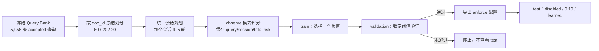

# AG News 单阈值监督校准实验框架

本文档说明如何使用已经冻结的 AG News 查询库，在训练集上学习一个攻击识别阈值，在验证集上锁定验证，最后只在验证通过后使用测试集进行三条件比较。

## 第一部分：实验规则

- 划分单位是 `doc_id`，同一文档的全部查询只能进入一个分区，避免数据泄漏。
- 100 个文档固定划分为 train/validation/test = 60/20/20；每个分区内成员与非成员数量相等。
- 监督标签只使用 `traffic_type`（attack/benign）。`membership_label` 仅用于检查划分平衡，不参与阈值训练。
- 训练只使用 `total_risk_score` 学习一个 `attack_detection_threshold`。
- 训练约束为良性查询 FPR 不超过 5%；在可行候选中，依次最大化四类攻击的最小文档平衡召回率、宏平均召回率，再降低 FPR。
- validation 只评估 train 得到的锁定阈值，不能重新搜索。通过条件是良性查询 FPR 不超过 10%，并且四类攻击的文档平衡召回率都大于 0。
- test 只在 validation 通过后运行，比较 disabled、固定 0.10 和学习阈值三种策略。

## 第二部分：模块与数据流设计



### 2.1 冻结划分

`src/miaguard/query_bank/threshold_split.py` 负责：

- 绑定查询库 ID、数据集 ID 和 `queries.jsonl` SHA256；
- 按成员/非成员分别做确定性排序；
- 生成互斥且全覆盖的 train、validation、test 文档列表；
- 拒绝覆盖已经冻结的划分文件。

当前冻结文件为 `data/query_bank_splits/ag_news_threshold_v1.json`，随机种子为 `20260818`。

### 2.2 统一会话构造

`src/miaguard/query_bank/sessions.py` 使用全部 accepted 查询，并按以下字段分组：

```text
partition + doc_id + traffic_type + attack_type
```

统一规则如下：

- benign、Direct RAG-MIA、S²-MIA、Masked MIA：同一文档的 5 条查询组成一个 5 轮会话；
- IA：同一目标文档的全部 IA 查询都使用，不跨文档串联；
- IA 查询数为 `N` 时，先计算 `K = ceil(N / 5)`，再把查询平均分成 `K` 个会话，因此每个 IA 会话为 4 或 5 轮；
- 每条 accepted 查询必须恰好出现一次；rejected 查询不进入实验；
- 会话之间必须清空窗口状态和风险缓存，防止跨文档、跨攻击类型污染。

真实审计结果保存在 `reports/ag_news_threshold_session_plan_audit.json`：

| 分区 | 文档数 | 查询数 | 会话数 |
|---|---:|---:|---:|
| train | 60 | 3,575 | 734 |
| validation | 20 | 1,194 | 248 |
| test | 20 | 1,187 | 244 |
| 合计 | 100 | 5,956 | 1,226 |

其中 IA 共 3,956 条查询、826 个会话；全部 1,226 个会话中，174 个为 4 轮，1,052 个为 5 轮。审计结果为 0 缺失、0 重复、0 越界查询。

### 2.3 Observe 风险评分与断点续跑

`src/miaguard/query_bank/threshold_scoring.py` 使用 `configs/defense/two_stage_direct_observe_threshold.yaml`：

- `window_size: 5`；
- `min_session_queries: 3`；
- `evaluation_interval: 1`；
- mode 必须为 `observe`，评分期间不真正限制 RAG 访问。

程序只有在一个会话全部评分成功后才原子写入该会话 shard。再次执行同一命令时，完整 shard 会跳过，缺失或损坏的 shard 会重新运行。最终按固定的会话和轮次顺序合并为 `risk_records.jsonl`。

每条风险记录包含查询 ID、文档/会话/轮次、attack/benign 标签、query/session/total 三个风险分数、风险类别与状态、检索 ID/分数、检测延迟和查询库溯源信息。

### 2.4 单阈值训练和锁定验证

`src/miaguard/supervised_threshold.py` 对每个候选阈值计算：

- 良性 query FPR 和 session FPR；
- 四类攻击的文档平衡 query recall 与 session recall；
- precision、recall、F1、balanced accuracy、AUROC、AUPRC；
- 首次检出轮次；
- 以 `doc_id` 为重采样单位的 95% bootstrap 置信区间。

“文档平衡”表示先计算每个文档内部的检出率，再对文档取平均。因此一个有 60 条 IA 查询的文档不会比一个有 30 条 IA 查询的文档拥有两倍训练权重。

如果不存在同时满足良性 FPR 约束且四类攻击召回率都非零的阈值，训练结果会明确写为 `infeasible`，不会回退到写死的 0.10。

### 2.5 独立访问控制阈值

学习结果写入可选配置项：

```yaml
policy:
  thresholds: [0.2, 0.4, 0.65, 0.85]
  attack_detection_threshold: 0.73  # 示例，必须由真实 validation 结果生成
```

旧的四个 `thresholds` 继续表示 L0–L4 严重程度边界。新的 `attack_detection_threshold` 只表示“是否认定为攻击”：

- 分数低于它时，访问级别最多为 L1；
- 分数达到或超过它时，访问级别至少为 L2；
- 已经达到旧 L3/L4 严重程度边界时，仍保留 L3/L4；
- 旧配置不包含该字段时，行为与修改前完全一致。

## 第三部分：执行顺序

以下命令均在项目根目录执行。Windows 上应使用项目 Conda 环境：

```powershell
conda activate MIAGuard
```

### 3.1 已完成：冻结划分与会话审计

当前冻结产物已经生成，无需重复执行。若要创建新版本，必须换新的 split ID 和输出文件名：

```powershell
python scripts/query_bank/build_threshold_split.py `
  --bank-id ag_news_queries_v1 `
  --dataset ag_news `
  --split-id ag_news_threshold_v2 `
  --seed 20260818 `
  --output data/query_bank_splits/ag_news_threshold_v2.json `
  --project-root .
```

只读会话审计命令：

```powershell
python scripts/audit_query_bank_threshold_sessions.py `
  --query-bank-id ag_news_queries_v1 `
  --dataset ag_news `
  --split data/query_bank_splits/ag_news_threshold_v1.json `
  --output reports/ag_news_threshold_session_plan_audit.json `
  --project-root .
```

### 3.2 Train observe 评分

这是长时间 GPU 任务，也是下一条真正需要执行的实验命令：

```powershell
python scripts/run_query_bank_threshold_scoring.py `
  --config configs/attacks/ag_news_calibrated_int8.yaml `
  --gateway-config configs/defense/two_stage_direct_observe_threshold.yaml `
  --source-run-id 20260717-ag-news-four-medium `
  --query-bank-id ag_news_queries_v1 `
  --dataset ag_news `
  --split data/query_bank_splits/ag_news_threshold_v1.json `
  --partition train `
  --output-root data/two_stage_threshold_runs/ag_news_threshold_v1 `
  --project-root .
```

中断后直接重复同一命令即可从完整会话 shard 继续。

### 3.3 只在 train 上选择阈值

```powershell
python scripts/calibrate_query_bank_attack_threshold.py `
  --run-dir data/two_stage_threshold_runs/ag_news_threshold_v1/train `
  --output reports/ag_news_threshold_v1_train_selection.json `
  --max-benign-fpr 0.05
```

若输出状态为 `infeasible`，实验停止，不运行 validation/test。

### 3.4 Validation observe 评分与锁定验证

将 3.2 的命令中 `--partition train` 改为 `--partition validation`，其余身份字段保持不变。评分结束后执行：

```powershell
python scripts/validate_query_bank_attack_threshold.py `
  --run-dir data/two_stage_threshold_runs/ag_news_threshold_v1/validation `
  --selection reports/ag_news_threshold_v1_train_selection.json `
  --output reports/ag_news_threshold_v1_validation.json `
  --max-benign-fpr 0.10 `
  --base-config configs/defense/two_stage_direct_observe_threshold.yaml `
  --export-config configs/defense/ag_news_supervised_threshold_enforce.yaml
```

只有输出 `status: passed` 时才会生成可用于 enforce 的配置。

### 3.5 Test observe 评分与快速策略审计

只有 validation 通过后，才将 3.2 的命令改为 `--partition test`。完成 test observe 评分后执行：

```powershell
python scripts/compare_query_bank_attack_thresholds.py `
  --run-dir data/two_stage_threshold_runs/ag_news_threshold_v1/test `
  --validation reports/ag_news_threshold_v1_validation.json `
  --gateway-config configs/defense/two_stage_direct_observe_threshold.yaml `
  --output reports/ag_news_threshold_v1_test_comparison.json
```

这个命令是快速的离线访问策略审计：三组策略共用同一份 test 风险记录和完全相同的查询顺序，不在 test 上重新搜索阈值。它用于核对 FPR、召回率以及 L0–L4 动作分布，不能代替正式攻击效果实验。

### 3.6 正式三条件回放

论文或最终报告中的防御效果必须重新执行 disabled、固定 0.10、学习阈值三种条件，分别生成 RAG 响应、攻击得分、事件和决策：

```powershell
python scripts/run_formal_query_bank_threshold_comparison.py `
  --config configs/attacks/ag_news_calibrated_int8.yaml `
  --gateway-config configs/defense/two_stage_direct_observe_threshold.yaml `
  --source-run-id 20260717-ag-news-four-medium `
  --query-bank-id ag_news_queries_v1 `
  --dataset ag_news `
  --split data/query_bank_splits/ag_news_threshold_v1.json `
  --validation reports/ag_news_threshold_v1_validation.json `
  --output-run-id ag_news_threshold_v1_formal `
  --project-root .
```

正式回放对三个条件使用同一组冻结 test 会话、相同顺序、同一个模型客户端、向量库、Direct Scorer 和 L0–L4 严重程度边界。每个会话结束后清空状态；输出分别保存 condition-specific events、decisions、四类攻击的文档聚合 MIA 指标和良性误报指标。

## 第四部分：一致性与停止条件

以下任一情况都会停止程序，而不是静默继续：

- 查询库 SHA256 与冻结划分不一致；
- train、validation、test 的 scorer/gateway/pattern library 身份不一致；
- scoring 输出目录中已有不同身份的 run manifest；
- validation 试图使用非 train 选择结果；
- test 身份与 validation 身份不一致；
- validation 未通过却尝试导出配置或运行三条件比较；
- 输出文件已经存在。

这样可以保证阈值只由 train 学习、只由 validation 决定是否放行，并且 test 始终保持最终一次性评估的角色。
