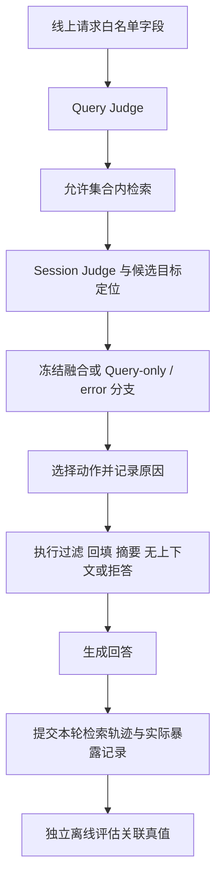

# MIAGuard 防御框架开发规格 v1.1

创建：2026-10-22；v1.1 修订：2026-10-31；数据复用澄清：2026-11-04（北京时间）。本规格是后续防御开发的执行依据；**规格要求不代表组件已实现**。当前 T01–T09 已完成工程验收，T10/T11 进行中，正式防御效果未验证。状态统一见[进度台账](../../DEFENSE_PROGRESS_ZH.md)，步骤见[实施计划 v1.1](../plans/2026-10-22-defense-framework-implementation.md)，实验规则见[协议 v1.1](../../DEFENSE_EXPERIMENT_PROTOCOL_ZH.md)。

## 1. 目标、范围和研究边界

2026-11-05 版本导航：开始选择数据、实验或框架身份前核对[当前版本总表](../../CURRENT_VERSIONS_ZH.md)，本规格 v1.1 不是查询库或代码发布版本；修改所用版本须同步总表并在台账登记。

目标：在正常问答损失与成本约束下，利用 Query/Session 风险控制检索证据，降低知晓防御的攻击者对检索库成员身份的推断能力。第一版固定已有 Judge 和冻结融合模型，先打通真实回答闭环，再比较动作与会话策略。

包含：在线适配、冻结融合、早期轮次、失败回退、请求级证据过滤/回填、真实摘要/拒答、实际暴露审计、开发与保留数据协议、固定/自适应攻击、联合评估。初版仅承诺单进程实验服务与单 session 隔离；不声称已实现分布式配额、多租户身份体系或差分隐私。身份接口预留允许文档集合，当前实验默认单授权范围。

用户意图不可直接观测。相同查询与历史可以来自正常用户或攻击者；单篇独有事实的准确回答可能本身泄露成员性。因此本项目报告可量化权衡和适用条件，不承诺所有正常问题无损且所有攻击无效。

## 2. 已有基础和冻结约束

- `progressive_judge.py` 输出 `ProgressiveJudgeTrace`；`TwoStageGateway` 使用 `RiskResult`。T02 已实现适配，T05 已接入冻结评分的 observe 流程，包括前两轮 Query-only 分支。
- `judge_score_frozen.py` 的模型输入顺序为 `[x1, x2_observed]`。logprob 为首个工程方案，rubric 作稳健性对照；不依据已查看的 test 重新选头。
- 默认冻结产物：`data/judge_score_frozen_v3_binary_logprob_20260920/logistic_l2.json`。其系数、截距、阈值不得覆盖；实际读取及哈希写入新 manifest。
- T06–T09 已完成证据过滤、统一动作执行、暴露记录和可恢复回放的工程实现；G1 依据 fake 全链路验收。live 已完成的 E00 只观察风险与完整上下文，未生成真实回答，不能将工程验收写作防御效果。
- 旧 `RiskAggregator`、旧 L0–L4 数字边界保留供历史复现，不得解释为新 Logistic 的风险等级。旧配置仍能运行原行为。
- 当前 test 已被查看，后续策略开发不使用其效果调参；旧数据重跑标 exploratory。

### 2.1 第一阶段数据复用优先（2026-11-04 澄清）

T10-D 先检查旧 train 的可复用范围，按第二阶段指标缺口补标或新增；四类攻击的旧查询、原文、评分输入和实现优先复用，不要求所有题目重新生成。旧 train 用于 engineering_only 联调及明确标记的探索性开发比较，正式数据与 gold、评估器和门禁仍须逐项满足。旧 validation/test 已使用，不能充当新的独立终测。

当前指定最新 `ag_news_queries_v2` / `ag_news_threshold_v2` 的 train 为复用入口，身份见[选择清单](../../../reports/defense_v1/T10/legacy_reuse_selection_20261104.json)。v2 扩充正常查询，文章、分区和攻击记录继承 v1；不能当新保留集。已有 Judge v3 冻结对照使用 v1，保留原实验身份，不因复用入口切换自动改名、重训或沿用不匹配的 Session trace。

旧问题须与原索引、原划分和原成员真值绑定；若迁移到 candidate06 新索引，重新核对成员身份及答案证据。旧攻击识别分数不替代开启防御后的真实回答结果。正常问题缺少参考答案和证据时，先补充并审核，不能因其旧状态为 accepted 就当正式 gold。candidate06 和现有 D-dev 队列继续承担补缺及新保留数据准备。具体用途、已有字段与待验收事项见[数据复用规则](../../DEFENSE_DATA_REUSE_ZH.md)。

## 3. 处理顺序与模块边界

| 文件（均相对项目根） | 新增/修改 | 职责 |
|---|---|---|
| `src/miaguard/online_judge_adapter.py` | 新增 | trace → RiskResult，同时保留完整 trace 与状态 |
| `src/miaguard/frozen_risk_scorer.py` | 新增 | 冻结 JSON 验证、数值计算、Query-only 与失败分支 |
| `src/miaguard/query_only_calibration.py` | 新增 | 仅 train 上的启动轮次阈值选择和独立产物 |
| `src/miaguard/defense_contracts.py` | 新增 | 线上请求、风险、执行结果和暴露事件的数据契约 |
| `src/miaguard/evidence_access.py` | 新增 | 文档/parent 过滤、回填、目标定位、动作执行 |
| `src/miaguard/exposure_store.py` | 新增 | 独立于冻结 Judge 的实际暴露记录、请求幂等 |
| `src/miaguard/defense_policy_v1.py` | 新增 | 有限候选策略与可解释动作选择 |
| `src/miaguard/defense_benchmark.py` | 新增 | 顺序闭环、分片续跑、统一身份和评估接口 |
| `src/miaguard/defense_metrics.py` | 新增 | 目标级攻击指标、正常效用、配对区间及成本 |
| `src/miaguard/defense_dataset.py` | 新增 | 新实验分区、重复组、答案/证据和标签隔离 |
| `src/miaguard/mirabel.py` | 新增 | 独立外部基线，不伪装成 Top-1/Top-2 近似 |
| `src/miaguard/adaptive_defense_attack.py` | 新增 | 只通过公开响应接口交互的自适应攻击与预算 |
| `src/miaguard/vector_store.py` | 修改 | 允许集合与排除集合检索，保留原 search 调用兼容 |
| `src/miaguard/two_stage_gateway.py`、`defense.py`、`defense_experiment.py` | 局部修改 | 依赖注入新分支，统一执行点，保留旧实验入口 |

表中“新增/修改”表示原开发范围，不表示当前是否未实现。T10 的数据模块已存在但生成质量待修订，T11 指标模块已有 engineering_only 版本；T13–T15 的未来模块以任务验收确认。不要从规划文件名推断 CLI 已支持所有参数。

禁止为了本计划顺带重构攻击实现或旧冻结流程。现有同责实现能满足接口时优先复用；若调整文件布局，在台账记录映射变更并同步本表。

## 4. 数据契约

### 4.1 在线输入与标签隔离

在线字段为 `request_id/session_id/query/allowed_doc_ids`。`allowed_doc_ids=None` 表示本实验的单一允许范围；空集合表示无访问权，二者不可混淆。检索文档以内部白名单对象传递，仅含 `doc_id/parent_doc_id/text/score`，剥离源表中的 `membership_label` 等字段。

`intent_label/attack_type/membership_label/target_doc_id` 只在离线标签表通过 request 或 target ID 关联，不能进入策略、Judge、摘要器或攻击者的隐藏输入。用户可见的整条问题是线上 Query；若历史攻击通过包装提示调用，记录 `user_query` 与服务端固定模板，不能仅因已知攻击类型给检测器换成更易识别的文本。

### 4.2 风险结果

保存 `head/x1/x2/fused_score/risk_source/status/trace_ref/artifact_sha256`。x2 缺失或失败时为 null，绝不能伪造有效零分。`risk_source` 只允许 `fusion/query_only/error`；status 保留 `ok/insufficient_history/session_error/query_error` 等明确状态。RiskResult 兼容字段需要数值占位时，必须保留不可用状态，新融合器在读数前先判状态。

保存 trace 的确定性数值核对误差上限为 1e-12；live Judge 重跑可能不同，必须另外记录分数差异，不将其当作数值融合错误。不能把融合分数解释为已校准概率。

### 4.3 动作、执行和暴露

动作枚举：`allow/hide_target_refill/sanitized_context/no_context_answer/deny/unavailable`。最后一项表示运行错误回退，不计作风险拒答。兼容旧动作名在适配层显式映射，不覆盖旧配置。

每条记录含 `recommended_action/applied_action/reason_codes/candidate_docs/excluded_parent_ids/delivered_evidence/response/status/latency_ms`。证据项含原文/摘要类型、来源 ID、文本哈希与受控 artifact 引用。保存实际生成输入，包括证据、用户问题、历史上下文和模板版本；日志中候选与实际交付须能逐项比较。

暴露按三个层次记录：检索命中、交给生成器、最终答复中的引用/可识别事实。第二层不等于第三层，摘要不等于零暴露。失败生成可能已经将上下文送入模型，因此记录尝试，不谎报“未交付”。

同一 `request_id + 输入哈希` 重试返回同一完成结果，不重复计入策略预算；相同 ID 不同输入拒绝。单 session 顺序处理，不同 session 状态隔离。若未来支持并发，先增锁与一致性测试再宣布支持。默认会话超时 1800 秒，重置事件记录；对外研究结论只覆盖该边界。

### 4.4 查询版本、审核与会话内容（v1.1 新增验收要求）

请求、离线答案/标签和证据须绑定同一查询版本；manifest 记录父数据/索引/审核哈希与新旧 ID 对照。查询、答案或历史轮次改变时建立新运行身份，不能复用旧 Session trace；同 ID 在不同版本中出现时必须由版本及输入哈希消歧。

正常题同时保存任务家族、可回答性、答案和全部必需证据；跨文档题必须两篇各有必要事实，答案中每项事实可回溯到对应原文。保留标题依赖/截断等审核信息；具体新增字段在 T10-D schema 中实现与验证后才声明可用。审核材料与离线标注可含证据和身份，但线上白名单不增加成员标签或审核结果。

模型预审状态与真实人员审核分开。现有两轮输出和开发 overlay 仍属模型建议，原任务 `review_status=pending`、`reviewed_by=null`；不得自动转为人工 reviewed。T10-E 验收正式 cohort 的答案/证据，T18/E07 另评价实际回答。

会话长度由 T10-C 的 D-dev 内容试点决定；2–3 轮是候选。不得通过重复问句凑五轮，亦不得仅保留两轮却声称验证 Session 策略。至少三轮的正常组须有真实递进，实际 Session 可用性按协议报告。缩短正常会话不改变第 5 节冻结 Judge 的第三轮启用规则。

## 5. 风险与会话规则

第 1–2 轮或 x2 不可用但 x1 有效时走 Query-only；Query-only 阈值由 T04 在既有 train 上选定并存入独立产物，绝不写回冻结融合。x1 失败时 enforce 返回统一 unavailable；observe 记录失败但仍执行无防御回答路径。摘要失败回退 no_context_answer，生成失败记 error，攻击预算仍扣除请求。

主 replay 按原 session 规划重建输入，确保保存 trace 的可比较性。长会话部署初版以当前轮加前四轮组成窗口；该窗口规则只定义新策略，不声称现有短会话指标已验证长会话效果。Session 每轮评估，暂不采用缓存间隔优化。原 Judge 仍接收控制前检索轨迹；暴露账本只供新策略使用，避免悄悄改变冻结 Judge 输入。

`observe` 始终 applied_action=allow，推荐动作独立记录；`disabled` 不调用 Judge；`enforce` 执行明确动作。模型或配置身份不匹配启动即失败，不能静默换模型、改分数头。

## 6. 访问动作规则

1. allow：原允许集合的 Top-k，不额外删证据。
2. hide_target_refill：请求级排除候选目标的 parent 及所有片段，按原相关度回填到 k；候选不足按倍增扩展至允许集合耗尽，记录短缺。不得永久删索引。
3. sanitized_context：使用固定、版本化的摘要模板实际生成变换证据；保存来源和实际文本；失败按规则回退。
4. no_context_answer：无检索正文，保持同一回答任务与诚实说明规则。
5. deny：固定拒答语义；不显式说明某个目标存在。

新执行器是唯一实际证据变换点，旧实验路径通过适配调用；不重复摘要。第一版过滤依据 doc_id，若 parent_doc_id 缺失则 parent=doc_id。重构片段结构前不得声称已有跨片段保护。

先做统一动作基线；策略版再将风险触发、定位和会话暴露组合。target 是内部候选而非目标真值。误定位时的正常证据损伤必须计入。弱定位时统一策略可用 no_context；禁止随机删最高相关文档后声称目标隐藏成功。

## 7. 门禁与变更规则

- G0：契约/融合离线测试通过、observe 身份可追溯，进入动作开发。
- G1：过滤真实执行、标签隔离、失败/重试/会话隔离通过，进入完整回放。
- G2：T10-E 正式数据与 gold 验收、T11 正式指标及 T12 实际动作比较就绪，产出安全/效用/成本配对结果，进入后续基线和策略开发。模型预审与 fake 指标不能单独放行。
- G3：策略、攻击校准器、评估器和新保留集身份冻结，进入最终评测。
- G4：终测分母/失败完整、区间正确、无测试调参，进入论文汇总。

门禁是产物检查，不额外要求用户逐步批准。设计变化先在进度台账登记原因、受影响任务与数据，再改规格/计划。查看终测后改策略必须开新版本及新终测，旧结果保留探索性标签。失败结果也可完成一个实验任务，但不能标为方法达到研究目标。

## 8. 需求追踪

| 规格内容 | 实施任务 |
|---|---|
| 身份、旧产物保护、契约与适配 | T01–T03 |
| 早期轮次与 observe | T04–T05 |
| 过滤回填与实际动作 | T06–T07 |
| 暴露、重试、会话隔离 | T08 |
| 闭环及可恢复运行 | T09 |
| 数据隔离、正常效用、统计 | T10–T11 |
| 基线、Mirabel、动态策略 | T12–T14 |
| 自适应与侧信道 | T15 |
| 冻结、终测、泛化与汇报 | T16–T18 |

变更版本：v1 / 2026-10-22 首次建立；v1.1 / 2026-10-31 对齐已有工程状态，补充查询版本、模型预审/真人 gold、会话内容和 G2 验收要求。新要求仍须按 T10–T11 实现验收，本次修订不代表功能已交付。

2026-11-04 v1.1 补记：澄清旧 train 复用与新保留数据的用途，T10-D 优先完成复用覆盖审计后按缺口补建；不改变正式审核、冻结或终测门禁。见台账 L097。

### 2026-11-05 工程执行优先级

固定v2 train小批的真实B0/B2已经24/24完成，见[报告](../../../reports/defense_v1/T10/fast_live_pilot_20261105_01/FAST_PILOT_REPORT_ZH.md)。下一步先利用现有输出完善解析/语义评分诊断，复用同一小批比较过滤回填与摘要，按观察到的缺口小量补充，不先重建全库。该路径为engineering_only，不改变正式规格、数据gold和门禁。评分需区别拒答、证据不足和格式错误；原始分数与生成输入应保留。

2026-11-11 候选方向补记：风险判断与候选来源定位分别记录。候选定位仅使用线上可见请求、检索证据及可用授权信息，输出可追溯证据和不确定状态；离线成员标签不进入策略。定位不清时比较固定拒答等回退，原Top-1保留基线；摘要的逐字和事实泄露检查为后续候选，具体实现及阈值待开发验证。执行与验收以主计划T10-D清单为准。

### 2026-11-11 用户确认的攻击类型驱动方向（待实现）

目标流程：用户请求 → Query Judge（满足条件时结合Session Judge）输出风险及可能攻击类型/证据 → 结合可信授权范围、定位和会话暴露选择相应访问动作 → RAG生成并记录实际交付及回答。类型来自在线判断结果，而非数据集离线 `attack_type` 真值；不得将用户自述用途当作授权证明。若部署具备可验证权限信息，应先满足其约束。

Direct的候选动作是限制上下文存在性确认与敏感原文交付；S²的候选动作是定位并限制原文续写；Masked的候选动作是限制原词恢复；IA的候选动作是结合会话轨迹和累计暴露，在多轮中调整限制。以上均为待验证的动作方向，不表示每类必须拒答或现有系统已实现。对多类型、类型未知或证据不足，按已版本化的风险与回退规则处理；同一请求不得根据数据集真值选择策略。

当前Judge trace和RiskResult含疑似类型与证据，冻结融合路径只输出首个 `predicted_attack_type` 且其assessment的query/session摘要未包含完整类型集合；真实试跑 B2/B3/B5/B6/B5_LOCATED/B5_CUE 为固定动作或规则候选，尚非按攻击类型自动选择动作。Judge类型为模型推断，现有类型输出不等于已校准的类型概率。未来在策略输入中保留查询和会话可追溯类型、状态与证据，分别处理多候选、缺失/失败和冲突；保护既有调用契约并在运行身份中记录策略版本。

### 2026-11-13 类型驱动开发候选

在 T10-D 的 live 回放入口接入 B_TYPE_V1。冻结融合摘要增加 Query 和 Session 各自的疑似类型列表及证据代码。策略只合并有效阶段的类型，风险低时放行，Query 或应运行的 Session 判断失败时返回 unavailable。风险高且类型缺失、未知或冲突时拒答。请求的检索允许集合同时约束首次检索和回填。

| 在线疑似类型 | 高风险动作 |
|---|---|
| Direct RAG-MIA | 拒答 |
| S²-MIA、Masked MIA | 唯一定位成功则排除该来源并回填，否则拒答。回填失败、空结果或排除来源重现时拒答 |
| IA | Session 判断为 IA 或同会话此前向回答模型交付过原文则拒答，其余高风险 IA 去掉检索上下文回答 |

决策记录保留疑似类型、历史原文交付请求数、选择理由和选定动作，执行记录保留最终动作、回填状态与实际交付。该候选用于检查类型能否支持策略，以及拒答、定位和正常质量之间的取舍。正式 T14 验收仍按主计划。

B_TYPE_V2 在高风险且唯一疑似类型为 Masked 时检查已有的原词恢复线索。线索命中时固定拒答，其他分支沿用 B_TYPE_V1。该分支针对开发首轮过滤后仍恢复原词的问题，单独记录线索和动作理由。

### 2026-11-17 多动作开发候选（尚未选定）

在不改变 B_TYPE_V2 身份的前提下，新增 `B_MULTI_SUMMARY` 与 `B_MULTI_NO_CONTEXT`。两者仅将“高风险、有效疑似类型唯一为 S²”分别改为摘要上下文、无上下文回答；其余沿用 V2：低风险放行，Direct 拒答；Masked 原词恢复线索触发拒答，否则定位后过滤并回填，定位或回填失败拒答；IA 在会话识别到 IA 或先前已交付原文时拒答，否则无上下文回答；未知或多个类型拒答，判断失败返回不可用。

摘要处理器本身会接触可信允许范围内的原文，不能把“回答模型没有收到原文”解释成处理器未接触或摘要不泄露；保存处理器输入证据摘要和实际交付内容，并逐项检查敏感信息。会话历史依据实际原文交付；请求允许集合来自可信应用，用户自述不是授权证明。开发集候选未选出前不替代 V2 或宣称正式方案优胜；详见台账 L198–L205。

### 2026-11-17 低风险线索候选

`B_NEXT_GOAL` 沿用V2的高风险、失败和可信允许范围处理。低风险时若命中长引用上下文存在性检查或三处以上带原词恢复指令的遮蔽线索则拒答。若查询同时出现 article/report 与明确 Yes/No/Unknown 格式，历史尚未交付原文时无上下文回答，历史已有原文时拒答。判断只使用查询文本、有效风险结果和实际会话交付记录。上述规则属于开发假设，需要测量正常误伤、输出信号和会话效果；不改变V2身份。
