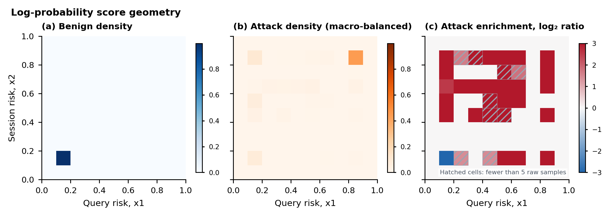
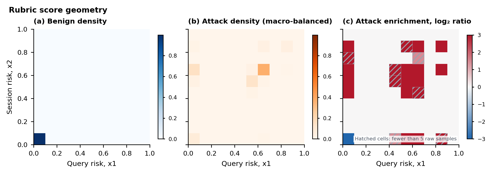
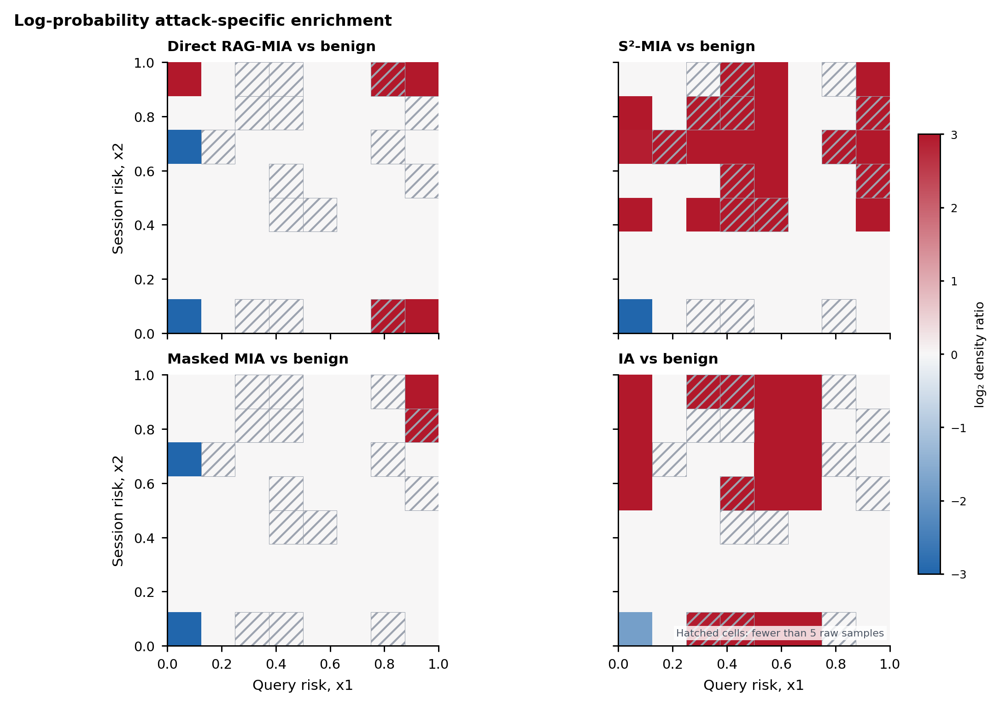
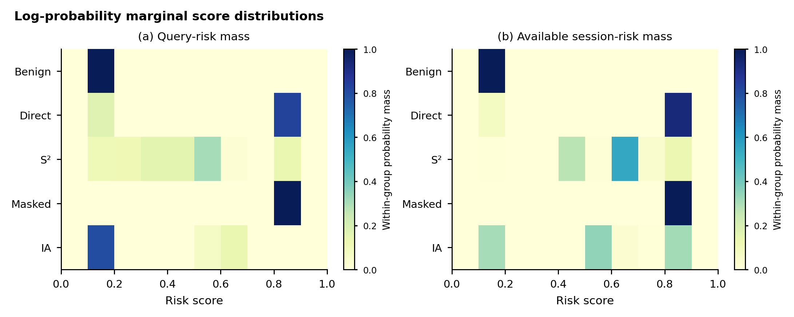
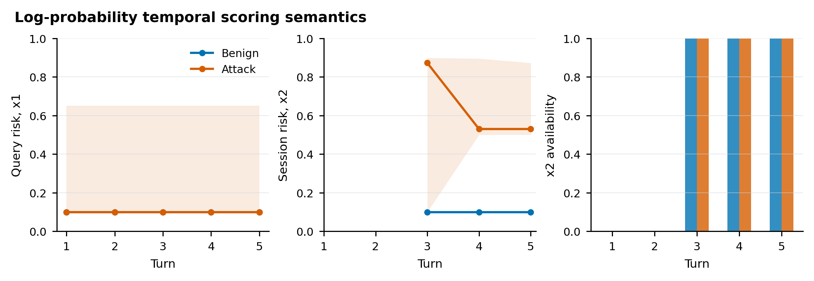
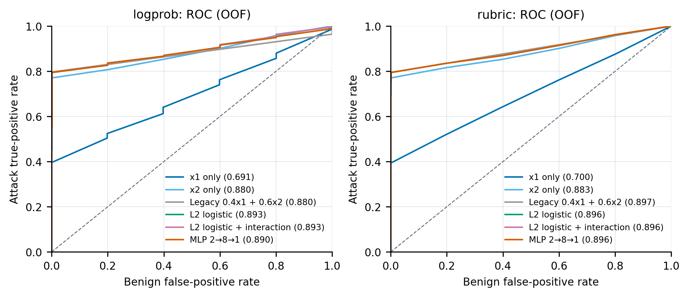
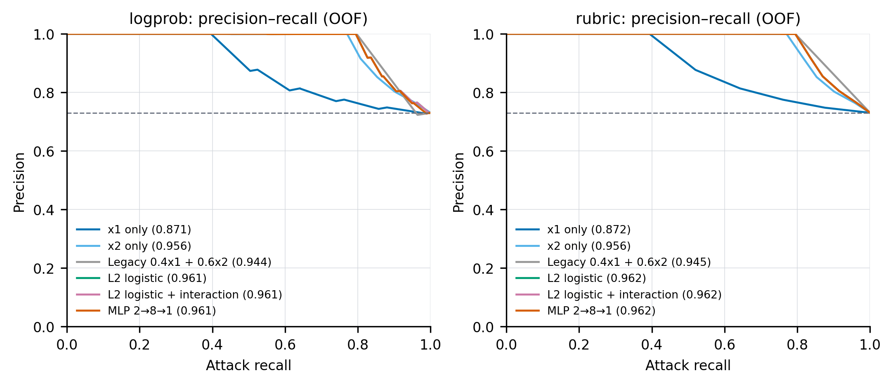
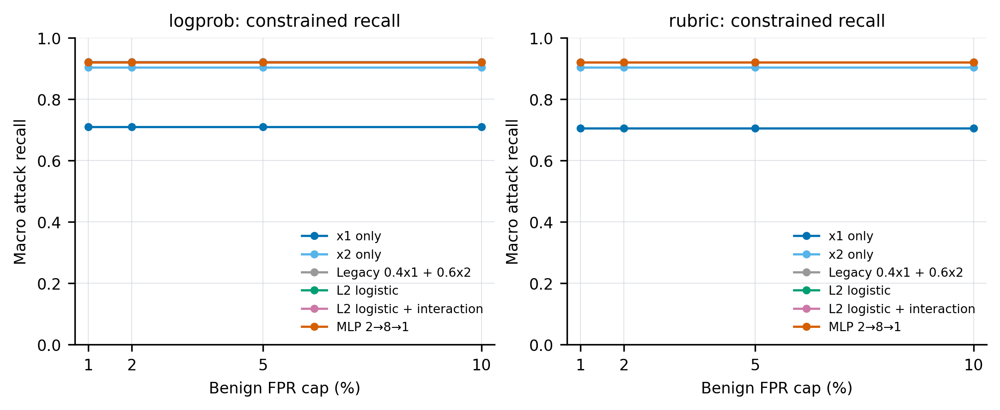
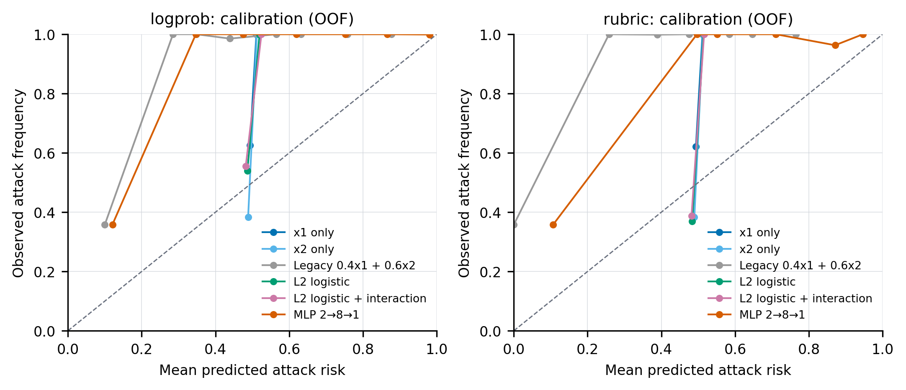

# AG News v2：Judge 双风险分数融合模型与图表说明

## 1. 文档目的

本文解释 AG News v2 训练集上已经完成的 Stage A（分数分布诊断）与 Stage B（学习式融合）实验。重点回答四个问题：

1. 两个输入分数 `x1`、`x2` 分别是什么，何时可以使用？
2. 分类器具体如何构建，为什么采用这些模型？
3. ROC、PR、低 FPR 召回和可靠性图是怎样计算的，应如何阅读？
4. 当前训练结果能说明什么，又**不能**说明什么？

本文是对已有冻结训练集实验的说明文件，不重新训练模型，不选择新的阈值，也不读取 validation 或 test 分区。

## 2. 实验对象与数据边界

### 2.1 冻结数据与来源

| 项目 | 数值/版本 |
| --- | --- |
| 查询库 | `ag_news_queries_v2` |
| 分析分区 | `ag_news_threshold_v2/train` |
| 文档数 | 60 |
| 原始 Judge 查询记录 | 4,579 |
| 会话数 | 970 |
| 良性查询 | 1,304 |
| 攻击查询 | 3,275 |
| 攻击类别 | Direct RAG-MIA、S²-MIA、Masked MIA、IA |
| Judge 评分头 | `logprob`、`rubric` |

完整训练分数首先被扩展为“每个查询 × 每个评分头”的长表，因此 Stage A 分数表有 9,158 行。两种评分头始终**独立**分析与训练；本实验没有把四个分数同时作为一个模型的输入。这保证 `logprob` 与 `rubric` 的比较是公平的：二者拥有相同数量的输入特征、相同训练协议和相同评估样本。

Stage A 产物位于：

- `data/judge_score_analysis_v2_20260902/train/`

Stage B 融合产物位于：

- `data/judge_score_fusion_v2_20260903/train/`

### 2.2 标签与分析单位

二分类标签为：

\[
y=\begin{cases}
0,&\text{benign}\\
1,&\text{Direct / S² / Masked / IA attack}
\end{cases}
\]

攻击类型**不进入分类器输入**。它只用于以下诊断：

- 检查模型是否只擅长某一种攻击；
- 计算四种攻击的宏平均召回率；
- 计算最弱攻击类型召回率；
- 绘制攻击类型分面图。

这与最终任务一致：访问控制器只需回答“当前记录是否高风险攻击”，不应依赖攻击类型的先验真值。

## 3. 两个风险特征与关键的时间语义

### 3.1 特征定义

对每个评分头 \(h\in\{\text{logprob},\text{rubric}\}\)，定义：

\[
x_1^{(h)}=\text{query\_trace}[h].\text{score}
\]

\[
x_2^{(h)}=\text{session\_trace}[h].\text{score}
\]

其中：

- `x1` 是查询级风险：Judge 仅根据当前查询及查询级线索输出的风险分数；
- `x2` 是会话级风险：Judge 使用同一会话的跨轮证据累积后输出的风险分数；
- 两类分数均在 \([0,1]\) 内，但 `rubric` 只取少数离散等级，`logprob` 更连续。

### 3.2 为什么不能把前两轮的默认 x2 当作低风险

训练记录中，第 1、2 轮的会话状态是 `insufficient_history`，而非“Judge 已判断低风险”。此时：

- `logprob` 的原始会话位置是默认锚点 `0.1`；
- `rubric` 的原始会话位置是默认档位 `0`；
- 这些值不代表真实观测到的会话风险。

审计结果表明 `x2` 的可用率为：

| 轮次 | 1 | 2 | 3 | 4 | 5 |
| --- | ---: | ---: | ---: | ---: | ---: |
| `x2` 可用率 | 0% | 0% | 100% | 100% | 100% |

因此，Stage B 的融合分类器只使用 `session_score_available=True` 的记录，即第 3–5 轮中会话风险真实可用的记录。每个评分头的融合队列包含：

- 2,639 条查询级决策；
- 712 条良性记录；
- 1,927 条攻击记录；
- 60 个文档。

这一定义十分重要：**当前 Stage B 是“会话证据已经形成后”的融合实验，不是第 1 轮即时拦截实验，也没有把完整会话结束后的 x2 回填给早期轮次。**

若将来研究“完整会话结束后回填 x2”的方案，应单列为 post-hoc audit / 会话结束审计，不可与在线逐轮访问控制结果混合。

## 4. 总体实验流程

```text
冻结 Judge 记录（train）
        │
        ├── Stage A：经验分布、相关性、时间可用性诊断
        │
        └── 筛选 x2 已真实可用的第 3–5 轮
                    │
                    ├── logprob: (x1_logprob, x2_logprob)
                    └── rubric:  (x1_rubric,  x2_rubric)
                              │
                    doc_id 分组的 5 折 OOF 训练
                              │
                    连续融合风险分数 s(x)
                              │
        ROC / PR / 低 FPR 阈值选择 / bootstrap 区间 / 图表
```

OOF（out-of-fold）预测是关键：某条测试记录的分数由**没有见过该文档**的模型产生。因而 OOF 分数比“同一训练样本上拟合后再预测”的分数更接近独立训练集性能，也适合用于训练集内的模型比较与阈值选择。

## 5. 为什么按 doc_id 分组交叉验证

同一文档可以生成多条相关查询和多个会话。如果把这些相邻记录随机分到不同折，模型可能在训练时已经见过同一目标文档的非常相似的攻击/良性形式，从而使评估结果虚高。

本实验采用：

- 5 折 `StratifiedGroupKFold`；
- 分组键为 `doc_id`；
- 每折约 48 个文档训练、12 个文档测试；
- 同一文档绝不同时出现在该折训练与测试部分；
- 每个评分头、每个模型都为 2,639 条记录各产生一次 OOF 分数。

最终共有：

\[
2\ \text{heads}\times 6\ \text{models}\times 2,639
=31,668
\]

条 OOF 预测记录。该数量不是 31,668 个独立样本；独立重采样单位仍是 60 个文档。

## 6. 训练时的类别与文档平衡

IA 查询数量显著多于其余攻击。如果直接最小化所有查询的平均损失，模型可能主要优化 IA，而牺牲 Direct、S² 或 Masked 的能力。为避免此问题，每一个训练折内使用固定样本权重：

| 分层 | 总训练损失权重 |
| --- | ---: |
| benign | 1/2 |
| Direct RAG-MIA | 1/8 |
| S²-MIA | 1/8 |
| Masked MIA | 1/8 |
| IA | 1/8 |

在每个分层内部：

1. 每个文档均分该分层的总权重；
2. 同一文档内的记录再均分该文档权重。

这种设计让训练目标同时重视良性误报与四类攻击，不让 IA 的记录数量主导损失函数。它不会复制或删除任何查询；评价指标仍在完整 OOF 记录上计算。

需要注意：加权训练改变了经验类别先验。因此逻辑回归输出在本文中应称为“融合风险分数”或“加权训练下的攻击分数”，而不是未经校正的真实部署后验概率。

## 7. 分类器设计

所有模型仅输入同一评分头的 \(x_1,x_2\)，不输入 `doc_id`、查询文本、攻击类型、路由决定、检索分数、会话 ID 或轮次。

### 7.1 对照与候选模型

| ID | 模型 | 输入 | 目的 |
| --- | --- | --- | --- |
| B1 | `x1_only` | \(x_1\) | 固定融合队列内，查询风险单独的判别力 |
| B2 | `x2_only` | \(x_2\) | 会话风险单独的判别力 |
| B3 | `legacy_0.4x1_0.6x2` | \(x_1,x_2\) | 原人工加权融合基线 |
| M1 | `logistic_l2` | \(x_1,x_2\) | 主学习式、可解释融合器 |
| M2 | `logistic_l2_interaction` | \(x_1,x_2,x_1x_2\) | 检验非加性互补关系 |
| M3 | `mlp_2_8_1` | \(x_1,x_2\) | 固定浅层非线性敏感性实验 |

这里的 B1 也只在第 3–5 轮队列上计算，因此它用于回答“在相同可用样本上，x2 是否增加了 x1 之外的信息”；它**不是**第 1–2 轮在线查询风险模型的最终性能报告。

### 7.2 人工融合基线

旧规则为：

\[
s_{\text{legacy}}=0.4x_1+0.6x_2
\]

它被保留为基线，而不是主方法。其价值在于直接回答：学习得到的融合是否真的优于一个已有的、人工设定的加权和？

### 7.3 主模型：L2 正则化逻辑回归

主模型为：

\[
s_{\text{LR}}(x)=\sigma(\beta_0+\beta_1x_1+\beta_2x_2)
\]

其中 \(\sigma(z)=1/(1+e^{-z})\)。实现采用 L2 正则化逻辑回归（`lbfgs` 优化器，`C=1.0`，最大迭代次数 1,000），并在每个交叉验证训练折内应用上述样本权重。

优点是：

- 只学习两个权重，不再人为假设 0.4/0.6；
- 输出连续融合分数，便于 ROC 与阈值选择；
- 决策边界在 \((x_1,x_2)\) 平面中是直线，容易解释；
- 参数量远小于独立文档数量，较不容易因模型容量过大而产生偶然拟合。

### 7.4 交互逻辑回归

交互模型为：

\[
s_{\text{int}}(x)=\sigma(\beta_0+\beta_1x_1+\beta_2x_2+\beta_3x_1x_2)
\]

其中 \(x_1x_2\) 允许模型表达“只有查询风险和会话风险同时升高时，攻击风险才显著增加”的协同效应。它仍然比黑盒网络更易解释。

### 7.5 浅层 MLP：只作为敏感性分析

MLP 的结构固定为：

\[
[x_1,x_2]\rightarrow\mathrm{Linear}(2,8)\rightarrow\mathrm{ReLU}
\rightarrow\mathrm{Linear}(8,1)\rightarrow\mathrm{sigmoid}
\]

实现采用一个 8 单元隐藏层、ReLU、L2 权重衰减 `alpha=0.01`、`lbfgs` 优化器和固定随机种子。它的作用不是取代逻辑回归，而是检查二维边界是否存在逻辑回归无法表达的明显非线性。

多层**纯线性**层并不能实现更复杂的边界，因为：

\[
W_3(W_2(W_1x))=(W_3W_2W_1)x
\]

仍然只是一次线性变换。只有 ReLU 这类非线性激活才使 MLP 能产生弯曲边界。

## 8. 阈值选择与统计评价

### 8.1 为什么不用 accuracy 选阈值

当前融合队列中攻击样本比例约为 73.0%，并且 IA 数量更多。总体 accuracy 或微平均召回可能掩盖某一种攻击的大量漏检，也无法直接表达“良性用户被误拦截多少”的安全代价。

因此主阈值规则是在 OOF 分数上求：

\[
\max_\tau\ \mathrm{MacroRecall}_{\mathrm{Direct,S^2,Masked,IA}}
\quad \text{s.t.}\quad \mathrm{FPR}_{\mathrm{benign}}\le\alpha
\]

其中 \(\alpha\in\{1\%,2\%,5\%,10\%\}\)。同分时依次选择：

1. 更高的攻击宏平均召回；
2. 更高的最弱攻击类型召回；
3. 更低的良性 FPR；
4. 更低的数值阈值 \(\tau\)。

预测规则为 \(s(x)\ge\tau\) 时判为攻击。

### 8.2 报告的指标

| 指标 | 含义 | 适合回答的问题 |
| --- | --- | --- |
| AUROC | 所有阈值上的排序能力 | 风险分数能否整体区分良性与攻击 |
| PR-AUC | 召回–精确率曲线面积 | 攻击正类条件下的识别质量 |
| 良性 FPR | 良性被判攻击的比例 | 用户误拦截代价 |
| 攻击宏平均召回 | 四类攻击召回的平均 | 是否均衡识别四种攻击 |
| 最弱攻击召回 | 四类攻击中最低召回 | 是否存在明显短板 |
| Brier score | 分数与二元标签的平方误差 | 仅作分数可靠性补充 |

### 8.3 文档级 bootstrap 区间

每个模型使用 1,000 次 bootstrap：每次有放回地重采样 60 个 `doc_id`，并带回该文档的全部 OOF 查询记录。报告 2.5% 与 97.5% 分位数作为 95% 区间。

当前 bootstrap 固定了“全 OOF 数据上已选定的阈值”，因此区间描述的是该固定阈值下的文档抽样波动，**没有**包含“再次选择阈值”带来的额外不确定性。这一点应在论文方法部分如实说明。

## 9. Stage A：分数分布图如何计算与解读

Stage A 图位于 `data/judge_score_analysis_v2_20260902/train/figures/`。每种评分头各有四张图。所有图使用固定坐标范围 \([0,1]\)，PNG 为 300 DPI，并同时输出矢量 PDF。

### 9.1 联合密度三联图

示例：



对 `rubric` 也生成了对应图：



仅使用 \(x_2\) 已可用记录，并将平面划为 10×10 个固定网格。三幅子图依次为：

1. \(P(x_1,x_2\mid\text{benign})\)：良性在二维平面中的文档平衡经验概率质量；
2. \(P(x_1,x_2\mid\text{attack})\)：先使四种攻击总质量相等、再在各类内按文档平衡后的攻击概率质量；
3. 截断后的对数密度比：

\[
\mathrm{enrichment}(x_1,x_2)=
\operatorname{clip}_{[-3,3]}
\log_2\frac{P(x_1,x_2\mid\text{attack})+10^{-4}}
{P(x_1,x_2\mid\text{benign})+10^{-4}}
\]

红色表示该格相对攻击更富集，蓝色表示相对良性更富集；原始样本数少于 5 的网格加斜线，提醒读者不要把该格当作稳定的频率估计。

这类图回答的是“二维空间中是否有可利用的经验差异”，而不是直接证明最终部署性能。logprob 中良性集中于低 \(x_1\)、低 \(x_2\) 区域；Direct 与 Masked 多位于高风险区域；IA 的 \(x_1\) 经常偏低，但会话风险 \(x_2\) 更高，正是会话证据具有增益的直观原因。

### 9.2 攻击类型富集小倍图

示例：



该图将 Direct、S²、Masked、IA 各画一面，分别计算该攻击相对良性的对数密度比。它不是多类分类器的输出，也不意味着要为四类攻击设置不同阈值；作用是检查“总体 attack vs benign 分离”是否隐藏了某一攻击类型的失败。

本实验中的关键阅读方式是：

- Direct、Masked：通常在查询级和会话级均高风险；
- S²：可能处于中间风险区，依赖两个分数共同提供信息；
- IA：查询级 \(x_1\) 往往低，主要依赖跨轮会话风险 \(x_2\)。

### 9.3 边缘频率图

示例：



行表示良性和四种攻击，左面板为 `x1`，右面板为可用 `x2`。每一行都归一化为 1，因此颜色表示“该类别内部落在该风险区间的比例”，不能横向比较样本总数。

它用于回答：哪一种评分头在单独使用时已经具有区分力？从当前数据可见，`x1` 对 IA 的作用较弱，而可用 `x2` 对 IA 的区分作用明显更大；这也解释了为什么 `x2_only` 的 OOF AUROC 远高于 `x1_only`。

### 9.4 时序与可用性图

示例：



三列分别展示各轮的：

1. `x1` 中位数与四分位范围；
2. `x2` 中位数与四分位范围；
3. `x2` 可用率。

这张图是所有后续融合结论的前提：第 1、2 轮没有可用 `x2`，所以不能将默认锚点解释为低风险。它也说明了为什么本文不对前两轮使用双分数模型。

## 10. Stage B：四张融合评估图如何阅读

### 10.1 ROC 曲线



每个面板对应一个评分头，曲线由全部 OOF 分数扫描阈值得到：

\[
\mathrm{FPR}=P(s(x)\ge\tau\mid y=0),\qquad
\mathrm{TPR}=P(s(x)\ge\tau\mid y=1)
\]

横轴越靠左、纵轴越靠上越好；虚线是随机排序基线。图例括号内为 AUROC。

当前结果显示：

- `x1_only` 约为 0.691（logprob）和 0.700（rubric），明显弱于其余模型；
- `x2_only` 约为 0.880 和 0.883，说明会话证据是当前主要的可分信号；
- L2 逻辑回归为 0.893 和 0.896，较单一分数更强；
- 交互项和 MLP 没有形成稳定、明显的额外收益。

ROC 展示整体排序能力，但其横轴的大部分区域对应很高的良性误报，在实际访问控制中未必可接受。因此必须结合低 FPR 图和阈值表，而不能只按 AUROC 选模型。

### 10.2 Precision–Recall 曲线



横轴是攻击召回率，纵轴为：

\[
\mathrm{Precision}=\frac{TP}{TP+FP}
\]

虚线为该融合队列中的攻击基率（约 73.0%）。曲线越靠右上、PR-AUC 越大越好。当前 L2 逻辑回归的 PR-AUC 为 0.961（logprob）和 0.962（rubric），高于人工融合的约 0.944–0.945。

但 PR-AUC 受攻击基率影响，不能直接与类别比例不同的数据集或部署场景比较；它是当前冻结训练队列中的辅助排序指标，不是访问阈值的主选择目标。

### 10.3 低 FPR 宏召回前沿图



横轴为允许的良性 FPR 上限 \(\{1\%,2\%,5\%,10\%\}\)，纵轴为四种攻击的宏平均召回。它直接对应访问控制场景：在给定的误拦截预算内，能保留多少攻击识别能力？

本次图中许多曲线呈水平，不表示实现出错。原因是 Judge 分数存在离散档位与大量并列值：在 1% 到 10% 的这些约束点上，最优阈值恰好相同，实际良性 FPR 约为 0.14%。下一个更低阈值会跨越一个较大的良性分数台阶并超过所有这些上限，因此没有新的可行阈值。

这种平台应在论文中如实报告；不要将 5% 写成“实际 FPR 恰为 5%”。当前的正确表述是：**在 FPR 不超过 5% 的约束下，选到的离散阈值实际 FPR 为约 0.14%。**

### 10.4 分数可靠性图



对每个模型，将 OOF 分数按 \([0,1]\) 的十个等宽区间分箱，仅保留每箱至少 5 条记录。横轴是箱内平均分数，纵轴是箱内真实攻击比例；虚线 \(y=x\) 表示理想校准。

这张图用于观察“高分区是否确实大多为攻击、低分区是否确实大多为良性”。不过它应被称为**分数可靠性诊断**，而非严格的概率校准证据，原因是训练使用了攻击类型平衡的样本权重。若未来需要把模型输出解释成真实攻击概率，应在独立校准集合上做预先定义的校准步骤（例如 Platt scaling），并单独验证。

## 11. 核心数值结果

下表为 OOF 点估计；方括号为文档级 1,000 次 bootstrap AUROC 或固定阈值宏召回的 95% 区间。

### 11.1 logprob 评分头

| 模型 | AUROC | PR-AUC | 5% 上限下实际 FPR | 宏平均召回 | 最弱攻击召回 |
| --- | ---: | ---: | ---: | ---: | ---: |
| x1 only | 0.691 [0.665, 0.718] | 0.871 | 0.000 | 0.709 [0.681, 0.737] | 0.209 |
| x2 only | 0.880 [0.863, 0.898] | 0.956 | 0.001 | 0.903 [0.885, 0.920] | 0.691 |
| Legacy 0.4x1+0.6x2 | 0.880 [0.859, 0.900] | 0.944 | 0.001 | 0.922 [0.908, 0.935] | 0.722 |
| L2 logistic | 0.893 [0.873, 0.912] | 0.961 | 0.001 | 0.920 [0.906, 0.934] | 0.720 |
| L2 logistic + interaction | 0.893 [0.873, 0.912] | 0.961 | 0.001 | 0.920 [0.906, 0.934] | 0.720 |
| MLP 2→8→1 | 0.890 [0.871, 0.910] | 0.961 | 0.001 | 0.920 [0.906, 0.934] | 0.720 |

### 11.2 rubric 评分头

| 模型 | AUROC | PR-AUC | 5% 上限下实际 FPR | 宏平均召回 | 最弱攻击召回 |
| --- | ---: | ---: | ---: | ---: | ---: |
| x1 only | 0.700 [0.676, 0.726] | 0.872 | 0.000 | 0.706 [0.678, 0.733] | 0.207 |
| x2 only | 0.883 [0.864, 0.901] | 0.957 | 0.001 | 0.903 [0.885, 0.920] | 0.691 |
| Legacy 0.4x1+0.6x2 | 0.897 [0.882, 0.913] | 0.945 | 0.001 | 0.920 [0.906, 0.934] | 0.720 |
| L2 logistic | 0.896 [0.877, 0.915] | 0.962 | 0.001 | 0.920 [0.906, 0.934] | 0.720 |
| L2 logistic + interaction | 0.896 [0.876, 0.915] | 0.962 | 0.001 | 0.920 [0.906, 0.934] | 0.720 |
| MLP 2→8→1 | 0.896 [0.876, 0.915] | 0.962 | 0.001 | 0.920 [0.906, 0.934] | 0.720 |

### 11.3 攻击类型诊断

以 5% FPR 约束下的 L2 逻辑回归为例：

| 评分头 | Direct | S² | Masked | IA |
| --- | ---: | ---: | ---: | ---: |
| logprob | 0.967 | 0.994 | 1.000 | 0.720 |
| rubric | 0.967 | 0.994 | 1.000 | 0.720 |

IA 仍是最弱攻击类型。这与 Stage A 的几何分布一致：IA 的单查询 `x1` 较弱，即使会话风险已参与融合，仍有一部分 IA 没有形成足够强的会话证据。

## 12. 当前结论应如何表述

可以作出的结论：

1. 在 `x2` 已真实可用的记录中，`x2` 提供了远强于单独 `x1` 的判别信息；
2. 联合使用 \(x_1,x_2\) 的学习式模型具有较高的 OOF AUROC 与 PR-AUC；
3. 在当前固定结构下，交互项和浅层 MLP 没有显示出超过简单 L2 逻辑回归的明确收益；
4. 两种评分头在点估计上非常接近，`rubric` 的 AUROC 略高，`logprob` 的结果也具有竞争力；
5. IA 是低 FPR 下的主要薄弱点，应优先通过改进跨轮证据累积与路由策略解决，而不是靠增加融合器深度解决。

不应作出的结论：

1. 不应说该模型已证明第 1 轮实时防御有效；当前融合队列排除了第 1、2 轮；
2. 不应将加权逻辑回归分数直接宣称为经过部署先验校准的攻击概率；
3. 不应仅因 L2 逻辑回归 AUROC 略高，就宣称它在 5% FPR 主目标上优于人工融合；当前点估计下 logprob 的人工融合宏召回略高，rubric 二者相同；
4. 不应在 validation 或 test 上重新比较模型、调节权重或修改阈值；
5. 不应根据攻击类型使用类型专属阈值，除非未来的系统目标明确改为多类策略并重新设计实验。

## 13. 建议的下一步冻结决策

在进入 validation 前，应先以训练 OOF 结果预先确定一条模型选择规则。例如：

1. 主安全目标为 5% FPR 上限下的攻击宏平均召回；
2. 若模型在该指标上的差异不超过预先定义的实用等价界，则优先选择参数更少、可解释性更强的 L2 逻辑回归；
3. 再以最弱攻击召回、AUROC 与稳定性为次级判据；
4. 固定评分头、模型结构、样本权重、训练随机种子、阈值规则和最终阈值；
5. 在全部训练文档上重新拟合已冻结的模型一次；
6. 只在 validation 集进行一次独立评估，test 集保持不可见。

由于当前 `logprob` 的人工融合在低 FPR 宏召回点估计上略高，而逻辑回归的 AUROC/PR-AUC 更高，不能仅依靠单一数字“自动宣布赢家”。更稳妥的论文叙述是：学习融合验证了双分数的可用性；但在该离散低 FPR 区域，尚未证明复杂度高于简单线性规则的模型带来实际召回增益。因此，最终候选应由预先冻结的主指标和简约性规则共同决定。

## 14. 可复现性文件

| 文件 | 内容 |
| --- | --- |
| `data/judge_score_analysis_v2_20260902/train/score_audit.json` | 原始查询数、x2 可用性与分数审计 |
| `data/judge_score_analysis_v2_20260902/train/separability_dataset.parquet` | Stage A 长表 |
| `data/judge_score_analysis_v2_20260902/train/separability_report.json` | 分布统计与相关性 bootstrap |
| `data/judge_score_fusion_v2_20260903/train/oof_predictions.parquet` | 所有模型的 OOF 分数 |
| `data/judge_score_fusion_v2_20260903/train/model_comparison.json` | AUROC、PR-AUC、阈值与 bootstrap 区间 |
| `data/judge_score_fusion_v2_20260903/train/threshold_selection.json` | 各 FPR 约束下的阈值 |
| `data/judge_score_fusion_v2_20260903/train/figure_manifest.json` | 图文件清单 |
| `data/judge_score_fusion_v2_20260903/train/run_manifest.json` | 输入哈希、分组折与运行配置 |
| `src/miaguard/judge_score_fusion.py` | OOF、模型、阈值和图表实现 |
| `src/miaguard/query_bank/judge_score_workflow.py` | Stage B 训练产物工作流 |

运行清单对每一个主要产物保存 SHA-256 哈希。融合运行已验证为：60 个文档、31,668 条 OOF 预测、12 个带哈希的产物；运行只读取 train 分区。
