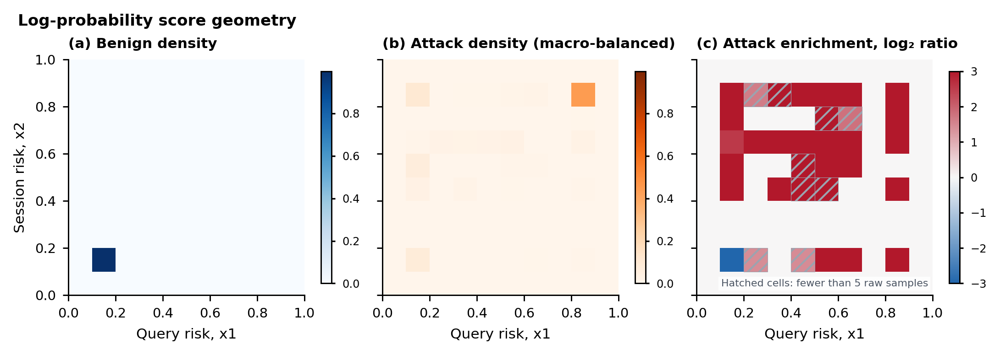
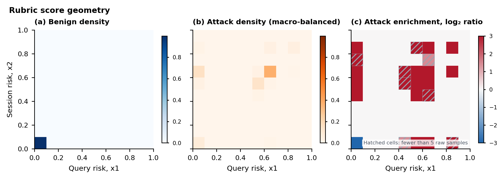
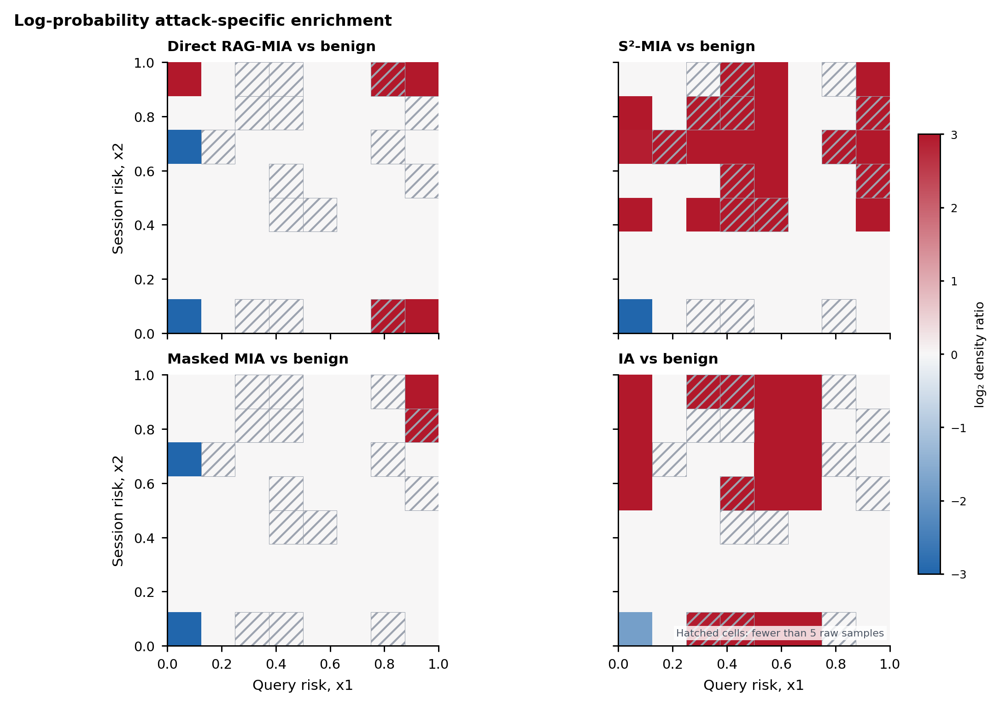
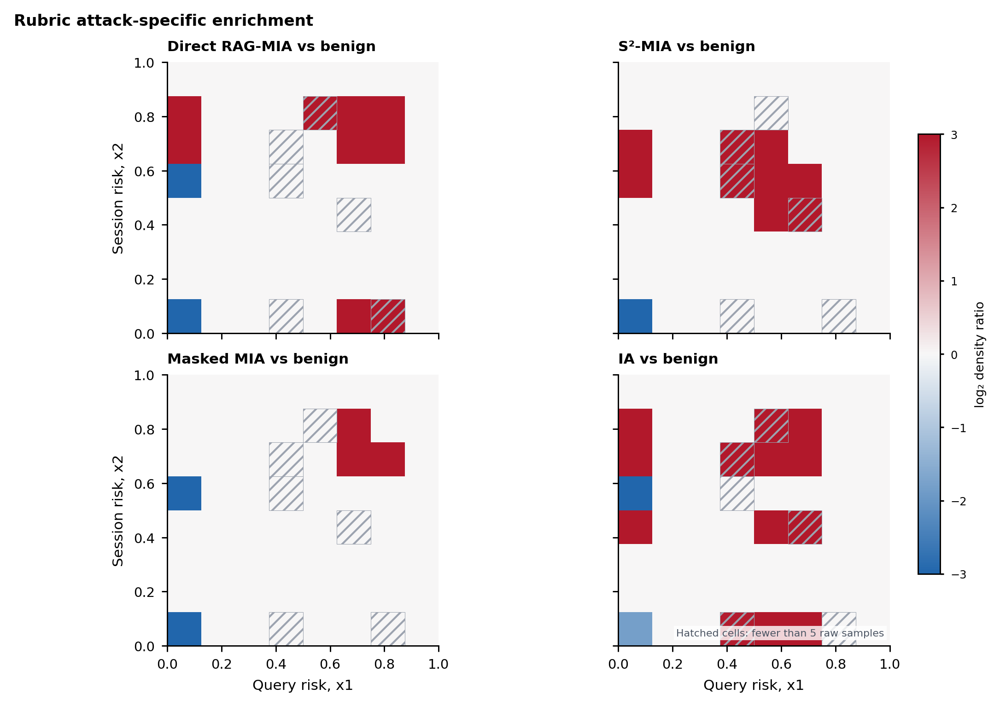
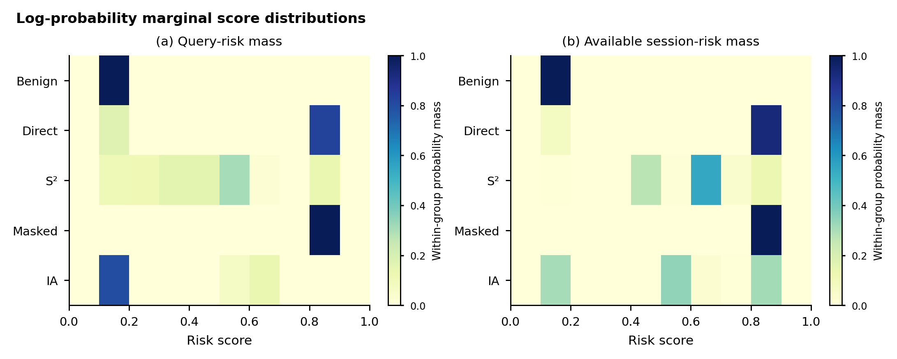
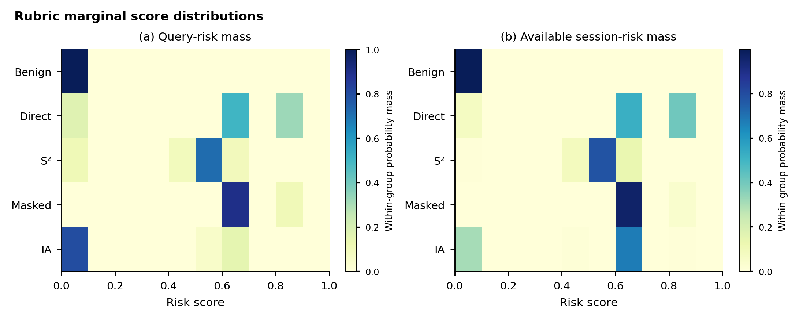
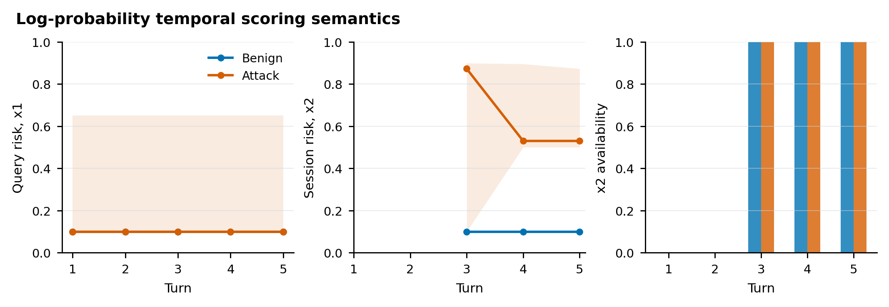
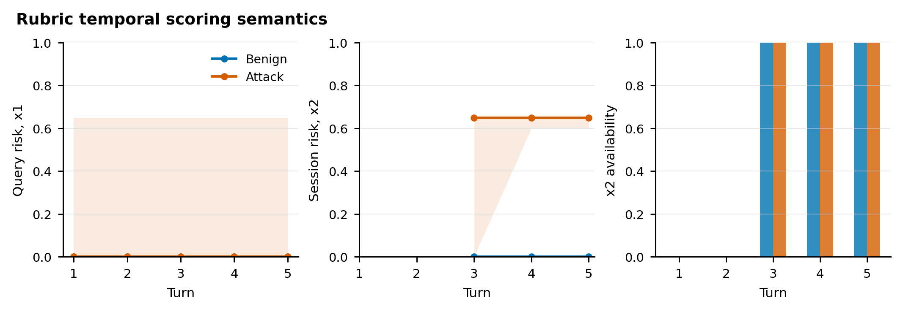

# AG News v2：LLM-as-Judge 双风险分数分布分析报告

## 1. 报告目的与结论边界

本报告分析 Progressive Judge 在冻结训练划分 `ag_news_threshold_v2/train` 上输出的两类风险分数：查询级风险 `x1` 与会话级风险 `x2`。目的不是在本阶段选择访问阈值，也不是报告最终检测性能，而是回答两个更基础的问题：

1. 良性流量与攻击流量在现有 Judge 分数空间中是否存在可利用的分布差异？
2. `x1` 与 `x2` 是否提供互补信息，从而值得在下一阶段用一个受限、可解释的融合模型进行比较？

本报告只使用训练集的冻结真值标签进行离线分析；攻击类型仅用于诊断性分面，绝不作为未来分类器的输入特征。图中出现的分离现象也**不能**直接解释为部署性能、泛化能力或适当的阈值。那些结论必须在文档分组的交叉验证、独立验证集和最终锁定的测试流程中获得。

## 2. 数据、运行与审计边界

### 2.1 冻结对象

| 项目 | 数值 |
| --- | ---: |
| 查询库 | `ag_news_queries_v2` |
| 冻结划分 | `ag_news_threshold_v2` 的 `train` |
| 文档数 | 60 |
| 查询数 | 4,579 |
| 会话数 | 970 |
| 良性查询 | 1,304 |
| 攻击查询 | 3,275 |
| Direct RAG-MIA | 300 |
| S²-MIA | 300 |
| Masked MIA | 300 |
| IA | 2,375 |

所有记录均由相同的 Progressive Judge 配置在 v2 会话上下文下获得。完整训练记录由两个互斥、已验证的 v2 子运行合并：新增良性相关会话为 1,034 条查询，剩余会话为 3,545 条查询。合并前逐会话验证覆盖无重叠且完整；合并清单保存两份来源记录的哈希。因此，本文的 `x1/x2` 不是从 v1 复制而来，也没有将 v1 风险分数混入 v2。

完整记录位于：

```text
data/progressive_judge_v2_full_train_qwen2_5_7b_bf16_20260902/train/
```

分析产物位于：

```text
data/judge_score_analysis_v2_20260902/train/
```

### 2.2 两个分数的语义

| 符号 | 含义 | 可用时机 |
| --- | --- | --- |
| `x1` | 当前单条查询的攻击风险 | 每一轮均可用 |
| `x2` | 当前查询连同该会话此前历史的攻击风险 | 仅第 3 轮及以后可用 |

Judge 同时输出两种评分头：

- **Rubric**：模型按五段风险规则给出离散化程度较高的风险分数。
- **Logprob**：比较低/中/高风险标签的概率，并按锚点 `(0.1, 0.5, 0.9)` 映射出的连续分数。

这两个评分头应平行比较。即使 logprob 的取值更连续，也不能在本阶段据此单独宣布其为最终方法。

### 2.3 `x2` 缺失不是低风险

第 1、2 轮的会话记录状态为 `insufficient_history`，因此其数值默认值只是一种占位输出，**没有**被视为观测到的低会话风险：

- 第 1、2 轮 `x2` 可用率为 0；第 3、4、5 轮为 1。
- 共排除 3,880 个默认会话分数（每个查询有两个评分头）。
- 对 logprob，这些占位原始值为 `0.1`；对 rubric 为 `0`。它们不会出现在任何 `x1-x2` 联合分布、相关系数或可用会话风险图中。

这项处理避免了一个关键错误：把“尚无足够会话历史”误解为“会话风险低”。后续融合模型也必须显式处理 `x2` 的可用性，而不能把早期轮次的缺失值直接当作正常样本。

## 3. 图形如何计算与绘制

### 3.1 共同预处理

1. 对每条 Judge 记录展开两行：一行 rubric、一行 logprob，得到 9,158 行长表。
2. 保留字段包括文档、会话、轮次、冻结真值、攻击类型、`x1`、原始 `x2`、观测到的 `x2` 及其可用标志。
3. 所有二维图仅使用 `x2` 已可用的记录，即 2,639 个查询级观测。
4. 所有坐标范围固定为 `[0, 1]`。PNG 为 300 DPI，PDF 为矢量版本；没有使用高斯拟合、KDE 平滑、3D 图或人为抖动。

采用经验分箱而不拟合高斯分布的原因是：rubric 分数存在大量合法并列值，良性分数高度集中，二者都不满足“连续、近似单峰正态”的自然前提。强行拟合正态曲线会制造不存在的平滑结构。

### 3.2 文档平衡与攻击类型宏平衡

IA 查询数远多于其他三种攻击。若直接按查询计数绘制攻击总体，IA 会主导整张图。因此密度图使用以下权重规则：

- 良性密度：先在每个 `doc_id` 内归一，再对文档平均；
- 攻击总体密度：先在每个攻击类型内做文档平衡，再对四种攻击类型等权平均；
- 攻击类型小图：该攻击类型内部做文档平衡。

所以“攻击密度”表达的是四种攻击的**宏平均几何结构**，而不是数据集中 IA 数量较多造成的微平均比例。相对地，时间图中的 attack 曲线为所有攻击查询的微平均摘要，主要用于说明在线可用性，不应用于比较不同攻击类型的难度。

### 3.3 联合密度三联图





每个评分头各有一张三联图。

- 面板 (a)：良性的文档平衡二维概率质量 `P(x1, x2 | benign)`；
- 面板 (b)：四种攻击宏平均后的二维概率质量 `P(x1, x2 | attack)`；
- 面板 (c)：每个网格的攻击富集程度：

  ```text
  log2((P_attack + 1e-4) / (P_benign + 1e-4))
  ```

  颜色截断在 `[-3, 3]`。红色表示相对攻击更富集，蓝色表示相对良性更富集。

三联图使用等宽 10×10 分箱。网格原始样本数少于 5 时加斜线；这些格的比率不应被当作稳定的频率估计。斜线不是第三种数据类别，也不是模型不确定度。

### 3.4 攻击类型富集小图





四张小图分别计算 Direct、S²、Masked 和 IA 相对于良性的 `log2` 密度比，使用 8×8 分箱和同一颜色范围。它们不是四个独立阈值，也不向模型泄露攻击类型；用途只是检查“总体攻击可分”是否由单一容易的攻击类型造成。

### 3.5 边缘概率质量图





该图将良性、四种攻击分别作为一行。在 `x1` 面板与可用 `x2` 面板中，分别计算该行内部、文档平衡后的 10 个分箱概率质量。每一行都归一化为 1，故颜色表示“该组内部落入此风险区间的比例”，不能拿颜色深浅比较不同组的样本总数。

它回答的问题是：某个评分头单独是否已有区分信息、以及不同攻击类型依赖查询级证据还是会话级累积证据。

### 3.6 时序与可用性图





左、中的折线分别为每轮 `x1` 和已观测 `x2` 的中位数，阴影为四分位区间；右图为 `x2` 可用率。它的首要作用是验证在线语义：第 1、2 轮不存在可用于融合的会话证据，第 3 轮起才允许讨论二维分数。

由于攻击微平均中 IA 数量较大，且不同会话可能在第 3、4、5 轮有不同组成，攻击的时间中位数不应被解释为所有攻击类型都以同样速度变化。攻击类型间的比较应优先看前述四张宏诊断小图。

## 4. 从图和统计量中观察到的信息

### 4.1 良性分数高度集中在低风险区域

在两种评分头中，良性 `x1` 的中位数均为最低风险值：

| 评分头 | 良性 `x1` 中位数 | 良性可用 `x2` 中位数 |
| --- | ---: | ---: |
| logprob | 0.1000 | 0.1000 |
| rubric | 0.0000 | 0.0000 |

联合密度图的良性质量因而集中在左下角。这表明当前训练良性集合在 Judge 的风险语言中大多被一致解释为无攻击线索；扩充到 1,304 条良性后，这一模式仍然成立。

这同时是一个需要在验证集继续检查的信号：过度集中的训练良性分数会让训练内图形看起来非常干净，但并不能保证面对分布外或更具迷惑性的良性提问时仍有相同的低误报率。因此，不应以“训练良性全为低分”作为最终部署理由。

### 4.2 `x2` 是攻击总体中更强的补充信息

攻击总体的中位数如下：

| 评分头 | 攻击 `x1` 中位数 | 攻击可用 `x2` 中位数 |
| --- | ---: | ---: |
| logprob | 0.1000 | 0.5378 |
| rubric | 0.0000 | 0.6500 |

攻击总体的 `x1` 中位数仍为最低风险，主要因为 IA 查询数量多且单条证据弱；而可用 `x2` 的中位数显著升高。换言之，只看单条查询会错过一部分攻击的累积行为，而会话级 Judge 提供了额外信息。

这不是“会话级分数必然优于查询级分数”的结论。Direct 和 Masked 的强单轮证据同样使 `x1` 很有价值；较准确的表述是：**两种分数针对不同攻击机制，存在值得用受控模型检验的互补性。**

### 4.3 IA 是互补性的主要动机

logprob 下 IA 的 `x1` 中位数为 0.1000，与良性相同；但 IA 的可用 `x2` 中位数为 0.5303，四分位距为 0.7730。rubric 下亦类似：IA 的 `x1` 中位数为 0，而可用 `x2` 中位数为 0.65。

IA 分面图显示，大量 IA 质量并不位于单条查询的高风险区域，而转移到中高 `x2` 区域。这与 IA 的设计相符：单条查询可能貌似普通，跨轮持续探测和检索集中度才构成主要证据。因此：

- 不能将 IA 的单条 `x1` 低分解释为“IA 是良性”；
- 不能把第 1、2 轮缺失的 `x2` 填成低风险后参与同一二维判断；
- 融合器若被训练，应把会话可用性作为明确的处理条件，而非把缺失误当成数值 0。

### 4.4 三类单轮攻击在 `x1` 上已有较强信号，但难度不同

logprob 的中位数揭示了三类单轮攻击的梯度：

| 攻击类型 | `x1` 中位数 | 可用 `x2` 中位数 | 解释 |
| --- | ---: | ---: | --- |
| Direct RAG-MIA | 0.8814 | 0.8911 | 显式成员/存在性线索强，两个头均高。 |
| Masked MIA | 0.8856 | 0.8958 | 恢复掩码内容的意图直接，分布最集中于高风险。 |
| S²-MIA | 0.4682 | 0.6640 | 查询级更具歧义，但会话级证据进一步抬升。 |
| IA | 0.1000 | 0.5303 | 单轮近似低风险，主要依赖跨轮累积。 |

rubric 呈现相同的相对结构，但只有少数离散档位：Direct 的 `x1` 中位数为 0.65、Masked 为 0.65、S² 为 0.60、IA 为 0。故 rubric 图更易出现同分块；logprob 提供较细的连续排序，但连续性本身仍需在独立验证中证明有用。

### 4.5 `x1` 和 `x2` 相关但不重复

Spearman 相关系数均只在 `x2` 已可用的记录上计算，并以 `doc_id` 为重采样单位进行 1,000 次 bootstrap：

| 评分头 | 全部可用记录 | 仅攻击记录 |
| --- | ---: | ---: |
| logprob | 0.473，95% CI [0.429, 0.519] | 0.417，95% CI [0.366, 0.466] |
| rubric | 0.456，95% CI [0.416, 0.497] | 0.293，95% CI [0.245, 0.343] |

相关性为正，说明两个风险头并非独立；但远低于完全单调对应，特别是攻击子集中 rubric 的相关性只有约 0.29。这与 IA 的“低 `x1`、中高 `x2`”模式以及 S² 的会话级抬升相一致，支持在下一阶段比较学习融合而非手工固定权重。

良性 logprob 的相关性接近 0，而 rubric 良性分数为常数，相关系数无定义。这不构成“良性两个分数相互矛盾”的证据，而是低风险集中、无足够变异度可估计相关性的结果。

## 5. 能得出的结论与不能得出的结论

### 可以得出

- 在冻结训练集上，良性与攻击在现有 `x1-x2` 空间中存在明显经验分布差异。
- 差异并非只来自单一容易攻击：Direct、Masked、S²、IA 在诊断分面中均具有相对良性的攻击富集区域。
- `x2` 对 IA、部分 S² 提供了单条 `x1` 所缺失的信息；下一阶段进行学习融合是有动机的。
- rubric 与 logprob 都应进入预先规定的对比，而不能仅依据视觉连续性选择 logprob。

### 不能得出

- 不能从这些训练图直接读出最终 FPR、召回率、AUROC、最佳阈值或访问控制收益。
- 不能据此选择某一攻击类型专属阈值；最终系统仍需一个全局二分类决策规则。
- 不能断言线性融合一定足够，或断言神经网络一定更好；这要由严格的 OOF 比较决定。
- 不能把 `x2` 缺失的早期轮次与已具备会话历史的后期轮次混为同一观测条件。
- 不能使用攻击类型、查询文本、文档 ID、会话 ID、路由输出或冻结真值作为融合器输入特征。

## 6. 对下一阶段融合器与阈值实验的建议

1. **先通过人工 Stage A 门控。** 本报告建议结论为“proceed”：两种评分头均呈现训练内可分性，且 `x1/x2` 并不完全重复，值得开展受限的 OOF 比较。
2. **按 `doc_id` 分组做五折 OOF。** 同一文档的相邻查询和会话绝不能跨训练折与验证折，避免信息泄漏。
3. **每个评分头单独建模并比较。** 预先固定比较：仅 `x1`、仅可用 `x2`、旧人工 `0.4x1+0.6x2`、L2 逻辑回归、深度 2 决策树和固定的浅层 MLP。攻击类型不进入特征。
4. **将早期轮次单独处理。** 推荐以“`x2` 是否可用”为显式状态：早期轮次走查询级决策；第 3 轮后再允许 `(x1, x2)` 融合。不要用 `x2=0` 代替缺失。
5. **在 OOF 攻击概率上选全局阈值。** 以良性 FPR 上限为约束，分别报告 1%、2%、5%、10% 下的攻击宏平均召回和最弱攻击类型召回；不要用总体 accuracy 选阈值。
6. **锁定后再做独立验证。** 固定提示词、Judge 配置、所选评分头、融合器参数和阈值后，只在 validation 上评估一次；测试集继续保持不可见。

## 7. 推荐的论文表述

可在方法或实验章节中使用如下表述，并按论文语言风格进一步压缩：

> 我们首先在训练划分上分析查询级风险与会话级风险的经验几何结构。会话风险仅在第三轮及以后纳入分析，以避免将历史不足时的占位输出解释为低风险。为抵消 IA 查询数量较多的影响，攻击联合密度对攻击类型进行宏平均，并在每一类内按文档平衡。结果显示，良性质量集中于低风险区域；Direct、Masked 与 S² 在查询级或会话级空间中呈现高风险富集，而 IA 的主要判别线索表现为会话级累积风险。该结果仅用于证明学习融合的可行性；融合器选择和全局阈值均通过文档分组的训练集 OOF 预测确定，并在独立验证集上锁定评估。

## 8. 可复现性与审计文件

- 完整 Judge 记录：`data/progressive_judge_v2_full_train_qwen2_5_7b_bf16_20260902/train/judge_records.jsonl`
- 完整运行清单：`data/progressive_judge_v2_full_train_qwen2_5_7b_bf16_20260902/train/run_manifest.json`
- 分数审计：`data/judge_score_analysis_v2_20260902/train/score_audit.json`
- 数值报告：`data/judge_score_analysis_v2_20260902/train/separability_report.json`
- 图文件清单：`data/judge_score_analysis_v2_20260902/train/figure_manifest.json`

报告生成时，完整训练 Judge 记录的 SHA-256 为：

```text
36922739f2a756e5f3ce89194a18a98152f01756019646f90efbdec35c328564
```
